<div align="center">

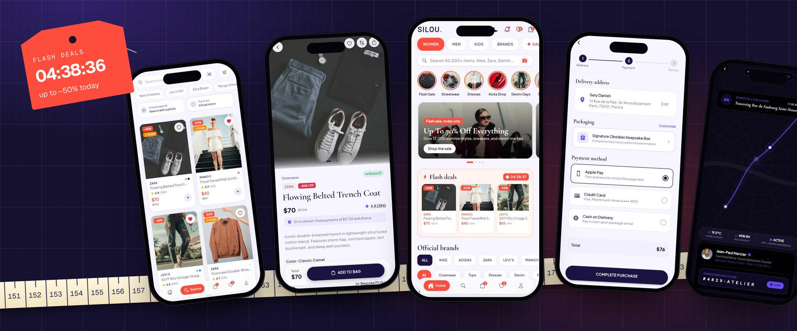

# SILOU<span style="color:#FF4D3D;">.</span>

**A premium fashion & streetwear shopping app, built with Flutter.**
<br/>
<sub>Frontend complete · backend coming next</sub>

<br/>

<a href="https://silou-fashion.netlify.app"></a>

<br/><br/>

[](https://flutter.dev)
[](https://dart.dev)
[](https://pub.dev/packages/get)
[](#-getting-started)
[](#tests)
[](#-current-status-frontend-only)

<sub><b>Browse</b> → <b>try on</b> → <b>personalise</b> → <b>check out</b> → <b>track</b>. Every screen is interactive.</sub>

</div>

---

## ✨ What is SILOU?

**SILOU** (from *silhouette*) is a mobile shopping app built for **fashion and streetwear
brands, boutiques and multi-brand retailers** who want to sell online with a premium,
editorial feel. Shoppers can discover new drops, try styles on, personalise pieces,
check out and track orders, all from one app.

### 🏬 What kind of store is it?

| Question | Answer |
| :--- | :--- |
| **Store model** | **One store brand, SILOU**, selling curated pieces from many fashion brands (Zara, Nike, Levi's, Mango…). Closest to **Zalando, ASOS or Farfetch**. |
| **Marketplace?** | **No.** It's not like Taobao or Shopee. Shoppers buy from SILOU and can't list or sell their own items. |
| **Online or physical?** | **Online first** (mobile app + web). A few flagship salons (Paris, Milan, London, Tokyo) are only for booking in-person fittings, not separate branch stores. |
| **Products** | **Brand-new, 100% original items only.** No second-hand pieces and no replicas or "grade" copies. Each premium piece comes with a digital authenticity passport. |
| **Real company?** | No. SILOU is a demo/portfolio brand built to showcase the app. |

It has two layers:

1. **The shop:** home feed, search & filters, product pages, wishlist, bag, promo codes, checkout and order tracking.
2. **The atelier:** premium extras that go beyond a normal store, like a 360° turntable, fabric zoom, virtual mirror, monogram studio, live runway, VIP club and salon booking.

### 📍 Current status: frontend only

> **This repository is the frontend (UI) of SILOU, and it is complete and fully interactive.**
> There is **no backend yet**. Products, orders, addresses, notifications and the user
> profile all come from **local demo data**, so every screen works offline and nothing is
> sent to a server. Accounts, payments and real order processing are not connected yet.

The UI was built first so the full shopping experience could be designed, tested and
demoed before any server work begins.

### 🔭 Future plan: add a backend

The goal is to grow SILOU into a real, production store by connecting it to a backend.
See the [Roadmap](#-roadmap) for what's planned.

---

## 📸 Screens

<table>
<tr><td align="center" width="25%">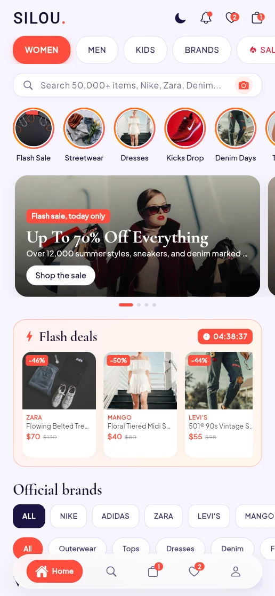<br/><sub><b>Home</b><br/>Stories, campaigns, flash deals</sub></td><td align="center" width="25%">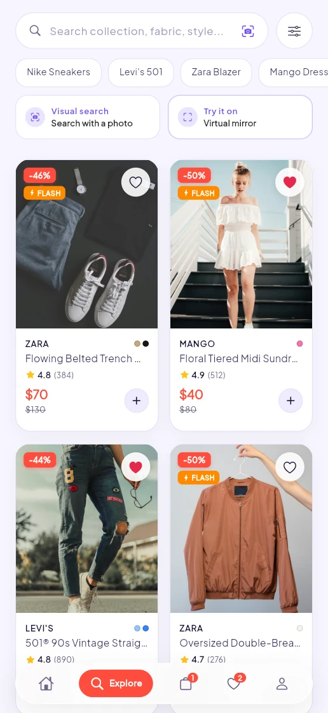<br/><sub><b>Search</b><br/>Filters, visual search, try-on</sub></td><td align="center" width="25%">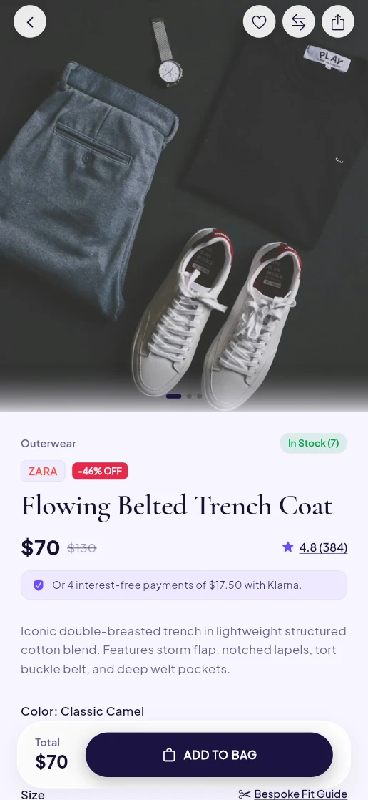<br/><sub><b>Product page</b><br/>Gallery, sizes, feature tools</sub></td><td align="center" width="25%">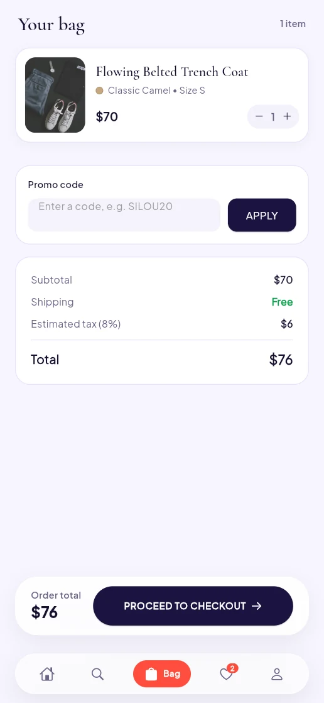<br/><sub><b>Bag</b><br/>Promo codes, live totals</sub></td></tr>
<tr><td align="center" width="25%">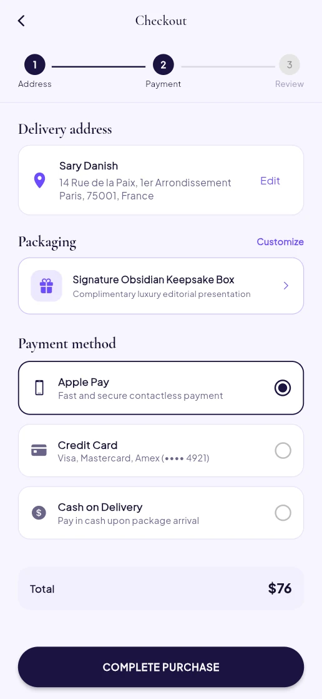<br/><sub><b>Checkout</b><br/>Address, packaging, payment</sub></td><td align="center" width="25%">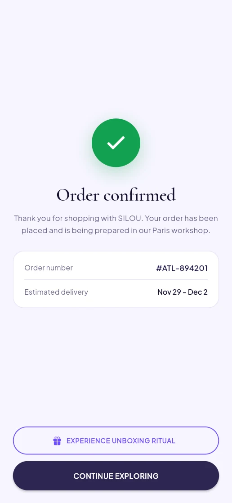<br/><sub><b>Order confirmed</b><br/>Order number & delivery window</sub></td><td align="center" width="25%">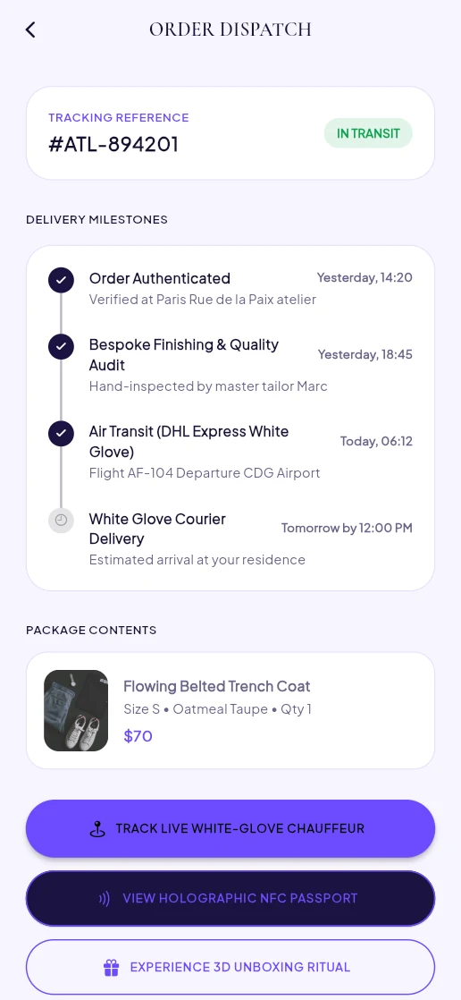<br/><sub><b>Order tracking</b><br/>Delivery milestones</sub></td><td align="center" width="25%">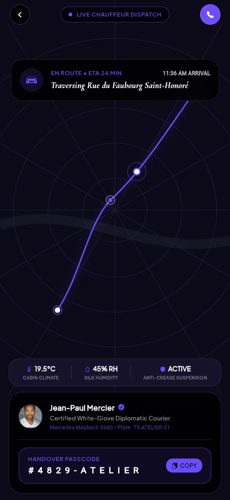<br/><sub><b>Live courier</b><br/>Real-time route map</sub></td></tr>
<tr><td align="center" width="25%">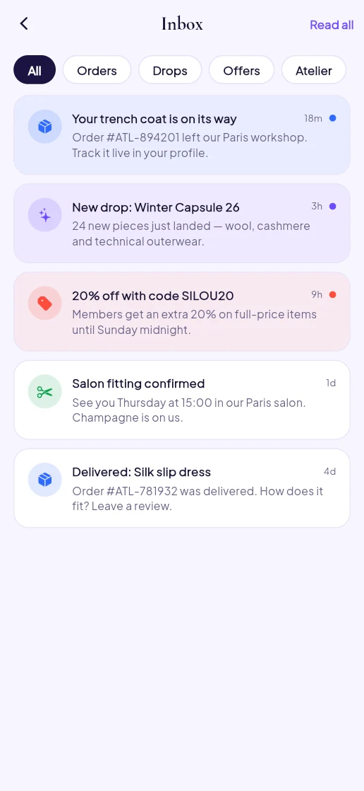<br/><sub><b>Inbox</b><br/>Filters, read state, undo</sub></td><td align="center" width="25%">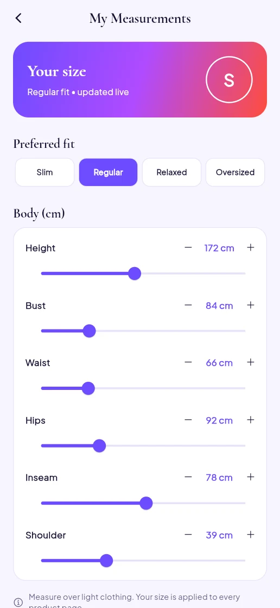<br/><sub><b>Measurements</b><br/>Live size recommendation</sub></td><td align="center" width="25%">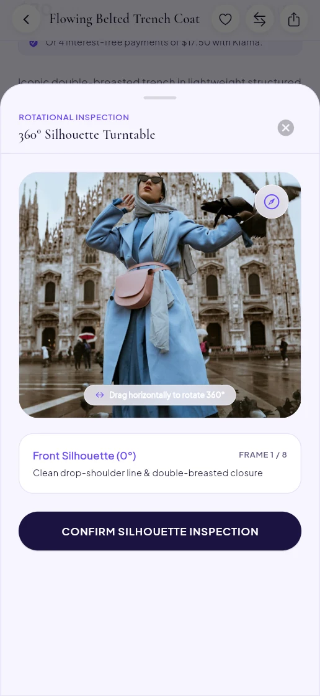<br/><sub><b>360° view</b><br/>Turn the piece around</sub></td><td align="center" width="25%">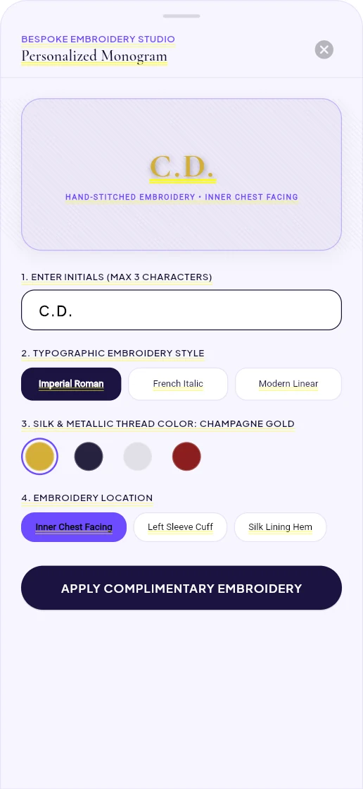<br/><sub><b>Monogram studio</b><br/>Personalise a piece</sub></td></tr>
<tr><td align="center" width="25%">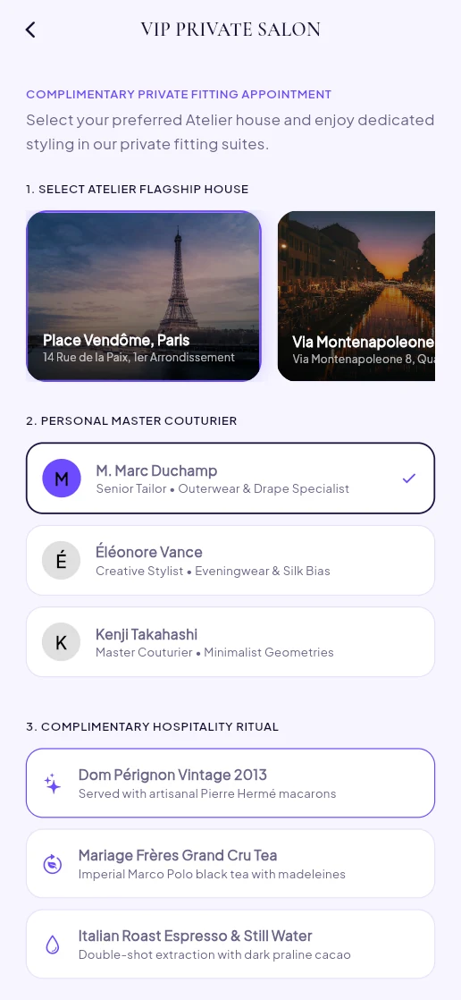<br/><sub><b>Salon booking</b><br/>Book an in-person fitting</sub></td><td align="center" width="25%">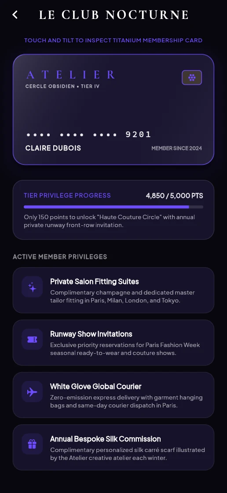<br/><sub><b>VIP club</b><br/>Membership & perks</sub></td><td></td><td></td></tr>
</table>

<p align="center"><sub>Captured from the real Flutter web build with its built-in demo data. See <a href="portfolio/overview.jpg">all screens on one page</a>.</sub></p>

---

## 📱 Features

### 🛍️ Shopping
| Screen | What you can do |
| :--- | :--- |
| **Home** | Stories, hero campaigns, flash deals, brand filter, best sellers, light/dark toggle, inbox bell |
| **Search** | Live text search, category / brand / size / price filters, sorting, visual search |
| **Product page** | Gallery, size & colour pickers, reviews, compare, add to bag with a bounce animation |
| **Wishlist** | Animated hearts, synced with every product card |
| **Bag** | Quantity stepper, swipe to remove, promo codes, multi-currency totals |
| **Checkout** | Address picker, gift packaging, 3D unboxing preview, success screen |
| **Order tracking** | Timeline and a live courier map |

### 👤 Account *(new)*
| Screen | What you can do |
| :--- | :--- |
| **Saved addresses** | Add / edit with a validated form, set default, swipe to delete. Also used as the address picker in checkout |
| **My measurements** | Sliders and +/- steppers for 6 body measurements, preferred fit, and a **live size recommendation** |
| **Inbox** | Filter by Orders / Drops / Offers / Atelier, unread dots, mark all read, swipe to delete with **Undo** |
| **My orders** | Full order history with In Transit / Delivered / Returned tabs, each opening its tracking page |

### 🪡 Atelier showcase
360° Turntable · Fabric Weave Loupe · Kinetic Drape · Bespoke Tailor · Virtual Mirror ·
Monogram Studio · Gifting · Style the Look · Runway Live · Magazine & Journal ·
Nocturne Vault · VIP Club · Salon Booking · Video Consultation · Authenticity Passport ·
Digital Wardrobe · Swatch Ordering · Heritage Archive · Acoustic Soundscapes

---

## 🎨 Design system

| Token | Hex | Used for |
| :--- | :--- | :--- |
| **Electric Violet** | `#6E4BFF` | Main accent, selected states, highlights |
| **SILOU Coral** | `#FF4D3D` | Brand mark, badges, primary shop CTAs |
| **Midnight Ink** | `#1B1442` | Primary buttons |
| **Ink Indigo** | `#16112F` | Headings & body text |
| **Lavender Mist** | `#F7F5FF` | Light canvas |
| **Midnight Indigo** | `#0C0A19` | Dark canvas |
| **Flash Tangerine** | `#FF8A00` | Deals & urgency |

A violet → coral **signature gradient** (`AppColors.signatureGradient`) is used on the splash screen and hero cards.

- **Light & dark themes** — switchable from Home or Profile.
- **Motion** — press-scale buttons, staggered list entrances, animated switchers, custom curves (`core/utils/motion_curves.dart`).
- **Haptics** — `HapticService` gives light / selection / success feedback on taps.
- **Glass** — `LiquidGlassContainer` for the floating tab bar and overlays.

---

## 🧱 Project structure

```text
lib/
├── main.dart                 # Composition root: error net, ApiClient, controllers, theme, routes
├── controllers/              # GetX state: AtelierController (shop), AccountController (account)
├── core/
│   ├── constants/            # AppColors, AppTypography (design tokens)
│   ├── network/              # ApiClient, Result<T>, AppFailure, LoadStatus
│   ├── theme/                # Light & dark ThemeData
│   └── utils/                # HapticService, MotionCurves
├── data/
│   ├── models/               # Typed models with fromJson / toJson
│   ├── repositories/         # CatalogRepository, AccountRepository (JSON → models, errors → Failure)
│   └── mock/                 # Demo data + MockApiClient (stands in for the REST backend)
├── modules/                  # One folder per feature
│   ├── shell/                # Bottom tab bar (Home · Search · Bag · Wishlist · Profile)
│   ├── home/  search/  product_detail/  cart/  checkout/  orders/
│   ├── account/              # Addresses, measurements, inbox, order history
│   └── try_on/  runway/  vault/  salon/  ...   # Atelier showcase screens
├── routes/                   # Named routes (GetX)
└── shared/widgets/           # Product card, image fallback, skeletons, error panel, glass
assets/google_fonts/          # Bundled Plus Jakarta Sans & Cormorant Garamond (OFL)
docs/API.md                   # REST contract the backend should implement
test/                         # Unit, widget and screen smoke tests
```

**Data flow:**

```text
Screens ─▶ Controllers ─▶ Repositories ─▶ ApiClient ─▶ (MockApiClient today, REST API later)
              ▲                 │
              └─ Result<T> ◀────┘   errors become friendly messages, never crashes
```

- **State:** GetX (`Rx` values + `Obx`). Controllers expose `LoadStatus` (loading / ready / error), and screens show a skeleton while loading and a "Try again" panel on failure.
- **Errors:** repositories return `Result<T>`. Failures are typed (`NetworkFailure`, `ServerFailure`, `NotFoundFailure`, `ParseFailure`) and each carries a plain-language message.
- **Images:** every network image has a sized fallback, so a missing photo never breaks a layout.

### Tests

| File | Covers |
| :--- | :--- |
| `test/data_layer_test.dart` | JSON round-trips, malformed payloads, error mapping, controller loading/error states, retry panel |
| `test/account_pages_test.dart` | Addresses, measurements, inbox, order history interactions |
| `test/screens_smoke_test.dart` | Opens 19 customer screens in light **and** dark mode and fails on any overflow or error |

---

## 🚀 Getting started

**Requirements:** Flutter SDK 3.x and a simulator, emulator, device or Chrome.

```bash
git clone https://github.com/danishsary8/siluo.git
```

```bash
cd siluo && flutter pub get
```

```bash
flutter run            # or: flutter run -d chrome
```

### Checks

```bash
flutter analyze
```

```bash
flutter test
```

### Web build (Netlify)

```bash
flutter build web --release --no-web-resources-cdn
```

`--no-web-resources-cdn` bundles the CanvasKit renderer so the site doesn't depend on Google's CDN. `netlify.toml` already publishes `build/web` with SPA redirects and security headers.

---

## 🧪 Try these

- Promo codes in the bag: **`SILOU20`**, **`SAVE20`**, **`ATELIER15`**, **`WELCOME15`**
- Profile → **Bespoke Measurements**: drag the sliders and watch your size change
- Checkout → **Edit** address: pick another address, or add a new one
- Home → 🔔 bell: open the inbox, swipe a message away, then tap **Undo**
- Tap 🌙 on Home to switch to dark mode

---

## 🗺️ Roadmap

**✅ Done: frontend**
- [x] Full shopping flow: home, search, product page, wishlist, bag, checkout, order tracking
- [x] Account pages: addresses, measurements, inbox, order history
- [x] Atelier showcase screens
- [x] Light & dark themes, motion and haptics
- [x] Web build deployed on Netlify

**🔜 Next: backend** *(planned)*
- [ ] **API & database** for products, inventory, prices and brands, replacing the local demo data
- [ ] **User accounts** with sign up, log in, password reset and a saved profile
- [ ] **Cart, wishlist and addresses synced** across devices
- [ ] **Real checkout** with a payment provider and order confirmation emails
- [ ] **Orders & delivery tracking** with live status updates
- [ ] **Push notifications** for orders, new drops and offers
- [ ] **Admin dashboard** for store owners to manage products and orders

The app is ready for this step. All remote data already flows through repositories and an
`ApiClient` interface, and the expected endpoints and JSON shapes are documented in
**[docs/API.md](docs/API.md)**. Connecting the backend means adding an HTTP `ApiClient` and
registering it in `lib/main.dart`, with no screen changes.

---

## ⚠️ Notes

- **Frontend only:** all data is local demo data and nothing is sent to a server (see [Current status](#-current-status-frontend-only)).
- Some images load from Unsplash, so they need an internet connection.

---

<div align="center">

**Made by [Danish Sary](https://github.com/danishsary8)** · Built with Flutter & GetX

</div>
