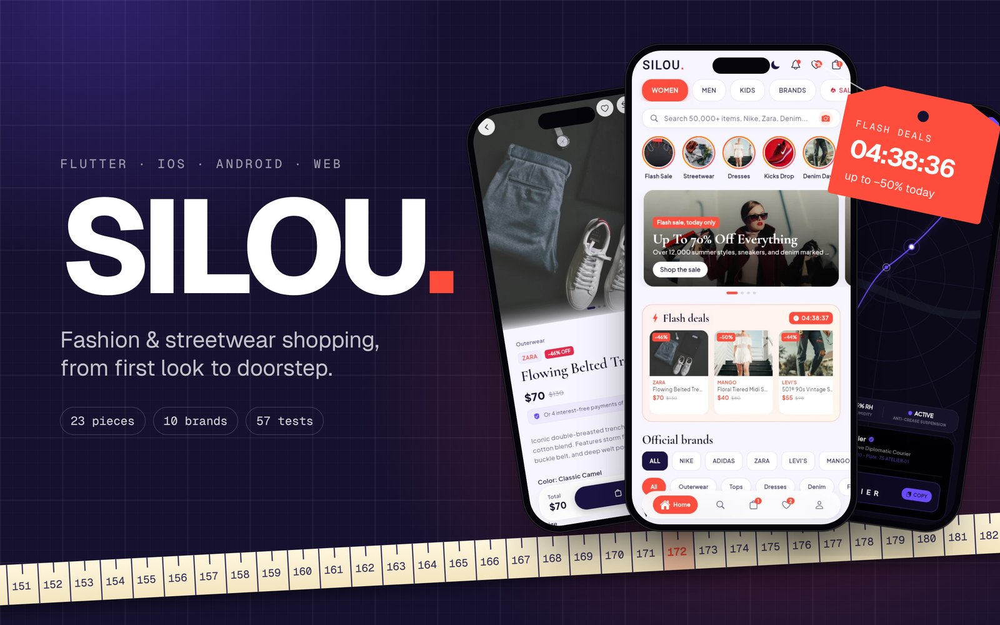
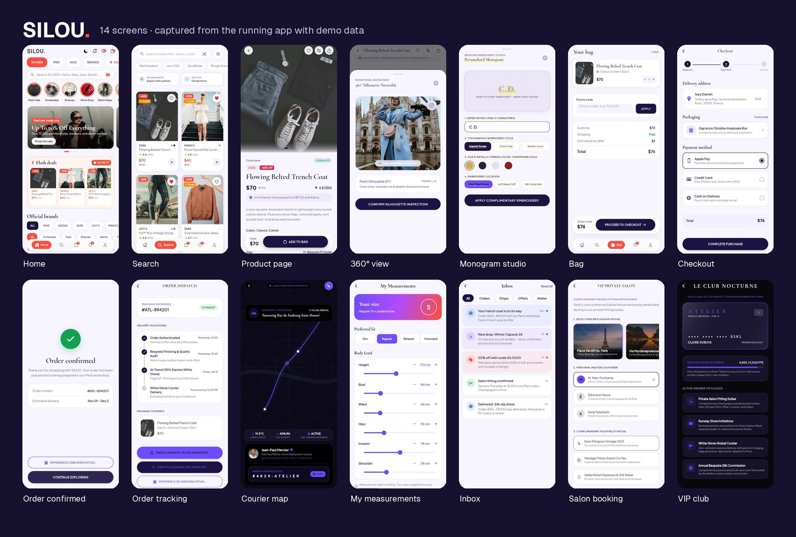

# Portfolio kit: SILOU

Everything needed to add SILOU to the portfolio (Danish_portfolio), shaped like the Bookly
case study. Captured from the real Flutter web build with its built-in demo data on 27 Nov 2026.

## What's here

| Path | What it is | Size |
| --- | --- | --- |
| `cover/card.webp` | Project card cover (16:10), title + one line | 3200×2000 |
| `cover/banner.webp` | Wide case-study banner (2.4:1), no title | 3840×1600 |
| `cover/*.jpg` | Same covers at half size (LinkedIn, slides) | |
| `cover/cover.source.html` + `cover/fonts/` | Source of both covers (Geist), open with `?v=card` or `?v=banner` | |
| `screens/m-*.webp` | 14 phone screens | 516×1118 (430×932 at 1.2×) |
| `silou.portfolio.ts` | Ready-to-paste entry: pitch, facts, problem, what I built, screens, stats, future plan | |
| `overview.jpg` | All 14 screens on one page | |

**Phone only.** As requested, there are no laptop screenshots, and the cover shows phones only.

## The cover

A new look, not the Bookly style: an ink-indigo (`#16112F`) pattern-cutting mat with SILOU
Coral (`#FF4D3D`), both taken from `lib/core/constants/app_colors.dart` (SILOU has no theme in
`ProjectCover.tsx` yet). Two details come from the app itself: a coral hang tag with the
home screen's **Flash deals 04:38:36** timer, and a tailor's tape stopped at **172 cm**, the
height preset on the My Measurements screen.

## Numbers (checked in the code)

23 demo products · 10 brands (`lib/data/mock/mock_atelier_data.dart`) ·
57 tests passing (`flutter test`) · 6 body measurements.

## Screens

| Group | Screen | File |
| --- | --- | --- |
| Shop | Home | `m-home` |
| Shop | Search | `m-search` |
| Shop | Product page | `m-product` |
| Atelier | 360° view | `m-turntable-360` |
| Atelier | Monogram studio | `m-monogram` |
| Shop | Bag | `m-bag` |
| Shop | Checkout | `m-checkout` |
| Shop | Order confirmed | `m-order-confirmed` |
| Account | Order tracking | `m-order-tracking` |
| Account | Courier map | `m-courier-map` |
| Account | My measurements | `m-measurements` |
| Account | Inbox | `m-inbox` |
| Atelier | Salon booking | `m-salon-booking` |
| Atelier | VIP club | `m-vip-club` |

## Adding it to the portfolio

1. Copy `screens/*.webp` into `src/assets/projects/silou/`, and the covers next to the other covers.
2. Add the `silou` image lookup to `src/lib/assets.ts` (lines at the top of `silou.portfolio.ts`).
3. Add `"silou"` to `Project["id"]`, to `ORDER` in `Projects.tsx`, and a `silou` theme in
   `ProjectCover.tsx` (e.g. stage `#16112F`, dot `#FF4D3D`), or just use `cover/card.webp` as the image.
4. Widen `CaseStudy.screens[].group` with `"Shop" | "Atelier" | "Account"`.
5. Paste the entry into `PROJECTS`, mapping each screen name through `ASSETS.projects.silouShot`.
6. There are no laptop shots: `desktop` equals `phone`. Show only the phone frame when they match.
7. `steps`, `practices`, `challenges` and `lessons` are empty on purpose; hide empty blocks.

## Notes

- All data is the app's built-in demo data (mock API, no backend). The demo profile and
  checkout address use the name "Sary Danish" because that is what the mock data contains.
- No demo banner or floating chat button exists on these screens, so nothing had to be hidden.
- The virtual mirror screen was left out: at 430 px wide its camera button runs off the right
  edge (an app layout bug worth fixing).
- Role: "Solo, frontend". Many commits in this repo were made with an AI coding assistant;
  adjust the wording if you want to say so.
